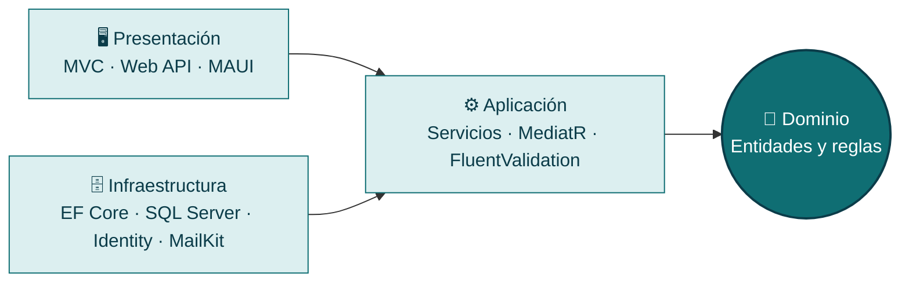

<!-- Encabezado -->

 

  

---

## 👋 Hola, soy Daferlin

Desarrollador full-stack especializado en **C# y .NET 9**. Construyo aplicaciones web y móviles donde **el negocio vive en el centro** y la base de datos, la web y el móvil son detalles que se pueden cambiar sin romper nada.

He construido **6 aplicaciones** con ASP.NET Core MVC, Web API, Entity Framework Core y SQL Server. Me gusta el código limpio, los repositorios ordenados y los equipos donde se revisa el trabajo de los demás.

> 🎯 **Busco una posición de desarrollo backend o full-stack .NET.** Si tienes una vacante o quieres conversar, escríbeme.

<table>
<tr>
<td width="50%" valign="top">

### 🔭 Ahora mismo
- 📱 Construyendo **ColmadoYa**: app de pedidos para colmados con .NET MAUI y API propia
- 🌿 Gestionando el proyecto con **GitHub Flow**: ramas main y develop, pull requests y tags
- 🐳 Siguiente paso en mi stack: **Docker y CI/CD**

</td>
<td width="50%" valign="top">

### 💪 Lo que aporto
- 🧅 Arquitectura por capas y dependencias claras
- 🔐 JWT, Identity, cookies y control por roles
- 🤝 Git con ramas, pull requests y tags
- 🧩 Proyectos entregados por módulos, con pruebas

</td>
</tr>
</table>

---

## 🧅 Cómo organizo mis soluciones

Las dependencias apuntan **hacia el centro**. El dominio no conoce la base de datos ni la web.

---

## 🚀 Proyectos

<table>
<tr>
<td width="50%" valign="top">

### 📱 [ColmadoYa](https://github.com/Josbel01/ColmadoYa)
`En desarrollo`

App móvil de pedidos para colmados con API propia, login **JWT** y roles. Solución de 5 proyectos con GitHub Flow.

</td>
<td width="50%" valign="top">

### 🏠 [RealEstateApp](https://github.com/Josbel01/RealEstateApp)
`MVC + Web API`

Gestión inmobiliaria con **4 roles** y autenticación híbrida: cookies en MVC y JWT en la API. Onion Architecture en 7 proyectos.

</td>
</tr>
<tr>
<td width="50%" valign="top">

### 🏦 [Artemis Banking Pro](https://github.com/Josbel01/Artemis-Banking-Pro-ABP-)
`Equipo de 4`

Sistema bancario con usuarios, préstamos, tarjetas de crédito y cuentas de ahorro. **MediatR**, **FluentValidation** y **Serilog**.

</td>
<td width="50%" valign="top">

### 🔗 [LinkUpPro](https://github.com/Josbel01/LinkUpPro)
`Red social`

Aplicación por módulos con **dos DbContexts**, ASP.NET Core Identity, correos con MailKit e interfaz responsiva.

</td>
</tr>
<tr>
<td width="50%" valign="top">

### 🗳️ [eVote360](https://github.com/Josbel01/eVote360)
`Votación electrónica`

5 capas desde cero con **12 entidades de dominio**. Validación de documentos por **OCR (Tesseract)** y notificaciones por correo.

</td>
<td width="50%" valign="middle" align="center">

### 🌐 Mira el detalle

Cada proyecto explicado con su **problema, arquitectura y retos resueltos**.

</td>
</tr>
</table>

---

## 🛠️ Stack

  

| | |
|---|---|
| **Lenguajes y frameworks** | C#, .NET 9, ASP.NET Core MVC y Web API, .NET MAUI, LINQ |
| **Datos** | SQL Server, T-SQL, Entity Framework Core (Code First, migraciones) |
| **Arquitectura** | Onion Architecture, Repository y Service genéricos, inyección de dependencias, MediatR, FluentValidation, AutoMapper |
| **Seguridad** | ASP.NET Core Identity, JWT, cookies, autorización por roles |
| **Herramientas** | Git y GitHub, Visual Studio, Serilog, MailKit, Tesseract OCR, pruebas unitarias |
| **Metodología** | Scrum, desarrollo incremental por módulos, trabajo en equipo |

---

### 📫 Hablemos

Si construyes con .NET y buscas a alguien que entregue y cuide su código, me encantaría conocer tu equipo.

